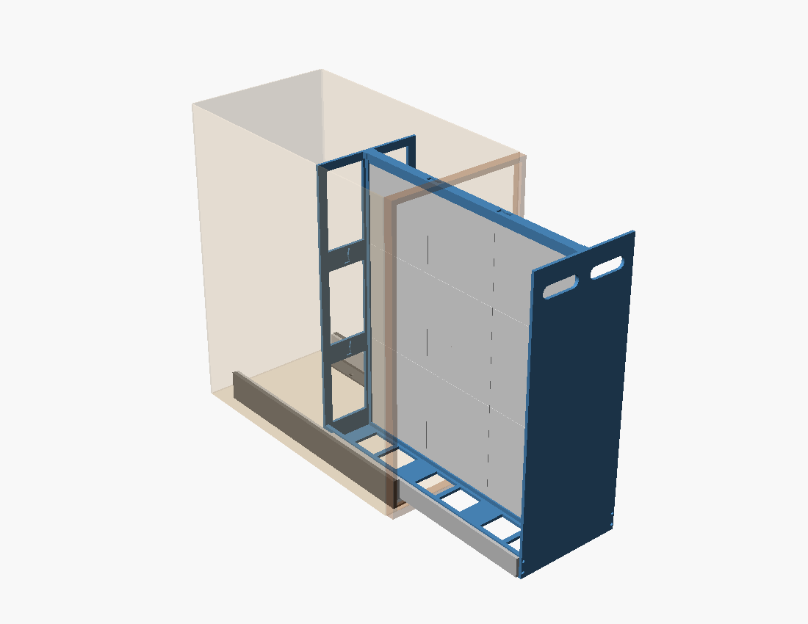

# PullGrid

Parametric, 3D-printed vertical pull-outs for deep cabinets — with openGrid faces, so the whole openGrid / Multiconnect ecosystem works on them.

Wall systems assume a flat wall you stand in front of. Deep cabinets don't have one: they have a face frame narrower than the interior, hinges in the way, and a back half nobody can reach. PullGrid generates a pull-out frame that fits through *your* opening, dodges *your* hinges and plumbing, and brings everything to the front.



**Try it: [phorbie.github.io/PullGrid](https://phorbie.github.io/PullGrid/)** — runs entirely in your browser.

> **Status: v1 beta.** Printable frame with metal slides; every part fits a 256 mm bed. Not yet proven in a real cabinet: print one base segment and dry-fit your slides first.

## How it works

1. **Describe the cabinet**: opening, depth, face frame or frameless, hinge side. Everything else has defaults ([parameters](docs/parameters.md)).
2. **Solve the sweep envelope**: the largest box that passes through the opening, fits the interior over its full travel, and misses every keep-out (hinges, pipes, disposal).
3. **Size the frame to whole openGrid cells**, pick the longest standard slide, split wide cabinets into side-by-side pull-outs, and split every part to fit your print bed.

## What you build

| | |
|---|---|
| **Fixed** | Two floor rails, screwed to the cabinet floor, carrying standard 45 mm full-extension ball-bearing slides |
| **Moving** | Base tray with slide cheeks, front plate with finger slots, ladder-frame rear plate, one dovetailed top rail per panel |
| **Panels** | Standard [openGrid](https://www.printables.com/model/1214361-opengrid-walldesk-mounting-framework-and-ecosystem) boards (Full is double-sided), held in grooves. Print them from openGrid's own files, so snaps fit exactly |
| **Joints** | Split parts are glued with printed bowtie keys; the steel slides bridge base and rail seams; plates bolt to the base with M3 + captive nuts |

The generator outputs every part already oriented for printing, the openGrid board list, a hardware list (slides, screws, M3), and install steps with rail placement.

## Try it

```sh
openscad scad/pullgrid.scad                       # open in the GUI, use the Customizer
openscad -o frame.stl -D 'part="frame"' \
  -D 'opening_w=300' -D 'interior_depth=580' scad/pullgrid.scad
tests/run.sh                                      # smoke tests
tests/interference.sh                             # no two parts overlap
tests/print_parts.sh                              # every part exports and fits the bed

# the site, locally
(cd site && npm ci) && bash site/build.sh && python3 -m http.server -d _site
```

Pushing to `main` runs the tests and deploys the site to the `gh-pages` branch.

Lines starting with `PULLGRID` in the console are the fit report (envelope, slide length, panel cells, what each keep-out cost).

## Roadmap

- [x] Fit solver: opening, hinges, keep-outs, non-square cabinets
- [x] Generator site: WASM render, 3D preview, inch/mm with fractions, share links
- [x] v1 printable frame: metal slides, openGrid panels, bed splitting, parts zip, hardware list
- [ ] First real print in a real cabinet, then tune auto defaults (face frame overhang, rail height, hinges)
- [ ] Printed rail option (no metal slides) for light loads
- [ ] Mid rails at board seams for heavy loads
- [ ] Lighter parts (front plate and base pocketing)
- [ ] Guided measuring flow
- [ ] 20-minute dry-fit outline print

## License

PullGrid by Phorbie Designs is licensed under [CC BY-SA 4.0](LICENSE): use it, remix it, sell prints of it — just credit **PullGrid by Phorbie Designs** and share remixes under the same license.

The generator site bundles third-party code under its own licenses: [OpenSCAD](https://openscad.org) (GPL-2.0, via [openscad-wasm](https://github.com/lorenzowritescode/openscad-wasm)) and [three.js](https://threejs.org) (MIT).
