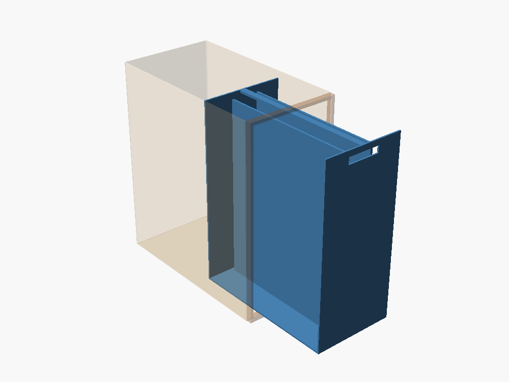

# PullGrid

Parametric, 3D-printed vertical pull-outs for deep cabinets — with openGrid faces, so the whole openGrid / Multiconnect ecosystem works on them.

Wall systems assume a flat wall you stand in front of. Deep cabinets don't have one: they have a face frame narrower than the interior, hinges in the way, and a back half nobody can reach. PullGrid generates a pull-out frame that fits through *your* opening, dodges *your* hinges and plumbing, and brings everything to the front.



> **Status: v0 / pre-alpha.** The fit solver works. The frame geometry is a placeholder and has not been printed. Don't print it yet.

## How it works

1. **Describe the cabinet** — opening, depth, face frame or frameless, hinge side. Everything else has sensible defaults ([parameters](docs/parameters.md)).
2. **Solve the sweep envelope** — the largest box that passes through the opening, fits the interior over its full travel, and misses every keep-out (hinges, pipes, disposal).
3. **Build the frame** inside that envelope, with panels snapped to whole 28 mm openGrid cells.

One OpenSCAD source feeds everything:

| Output | What |
|---|---|
| Generator site (`site/`) | OpenSCAD → WASM in the browser, 3D preview, guided measuring |
| MakerWorld / Printables | Same `.scad` in the native customizer + pre-sized common cabinets |
| This repo | Source, issues, contributions |

## Try it

```sh
openscad scad/pullgrid.scad                       # open in the GUI, use the Customizer
openscad -o frame.stl -D 'part="frame"' \
  -D 'opening_w=300' -D 'interior_depth=580' scad/pullgrid.scad
tests/run.sh                                      # smoke tests
```

Lines starting with `PULLGRID` in the console are the fit report (envelope, slide length, panel cells, what each keep-out cost).

## Roadmap

- [ ] Real openGrid tile geometry on panels (use the openGrid/QuackWorks OpenSCAD libs, don't reinvent)
- [ ] Slide hardware mounts — pick 2–3 common full-extension slides and model their hole patterns
- [ ] Fully printed rail option
- [ ] Split parts to fit print beds (256 mm default)
- [ ] 20-minute dry-fit outline print
- [ ] Better keep-out solver (notching around hinges instead of shrinking the whole side)
- [ ] Generator site: WASM render, three.js preview, guided measuring, inch/mm toggle
- [ ] First real print in a real cabinet

## License

MIT — see [LICENSE](LICENSE).
