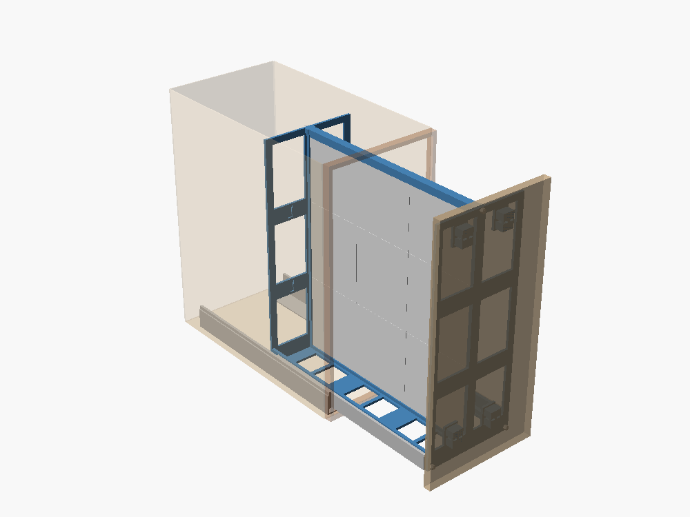
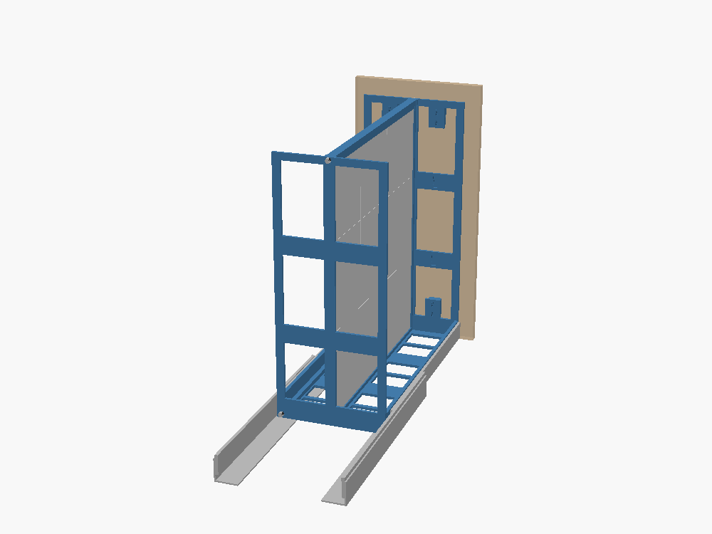

# PullGrid docs

PullGrid turns a deep cabinet into a pull-out. You enter your cabinet's measurements, and the [generator](https://phorbie.github.io/PullGrid/) gives you 3D-printable parts sized to it, a shopping list of a few cheap hardware-store items, and install steps. The panels are standard [openGrid](https://www.printables.com/model/1214361-opengrid-walldesk-mounting-framework-and-ecosystem) boards, so the whole openGrid accessory ecosystem snaps onto both sides.

> **Beta.** PullGrid hasn't been proven in a real cabinet yet. Before printing everything, print one base piece and dry-fit your slides: see [Test print first](printing.md#test-print-first).

## Start here

1. **[Measure your cabinet](measuring.md)**: three numbers for most cabinets, five minutes with a tape measure. Plus one per [fixed shelf](measuring.md#fixed-shelves), if you have any.
2. **[Decide about your door](door-mount.md)**: mount it on the pull-out (recommended) or keep it hinged. Keeping a door that [only opens to 90°](door-mount.md#when-the-door-only-opens-to-90)? The pull-out next to it goes one-sided, and you can [choose sides](door-mount.md#choosing-sides-for-each-pull-out) for each pull-out.
3. **Run the [generator](https://phorbie.github.io/PullGrid/)** and download the parts zip.
4. **[Buy the hardware](hardware.md)**: slides, aluminum angle, threaded rod, screws. Found in any big-box store in the US, Canada, UK, Ireland, Australia and New Zealand.
5. **[Print](printing.md)** the parts and the openGrid boards.
6. **[Assemble and install](assembly.md)**.

Stuck? See [Troubleshooting](troubleshooting.md).

## How it works

| Part | What it is |
|---|---|
| **Floor rails** | Two pieces of aluminum angle screwed to the cabinet floor (or printed rails if you'd rather not cut metal) |
| **Slides** | A standard pair of 45 mm full-extension ball-bearing drawer slides |
| **Carriage** | Printed base, front plate, rear plate and top rail, clamped into one box by threaded tie rods |
| **Panels** | Standard openGrid boards standing in grooves, front to back |
| **Door** | Your existing cabinet door, taken off its hinges and screwed to printed brackets on the front |

The generator works out the biggest pull-out that fits through your opening and misses anything in the way, sizes it to whole 28 mm openGrid cells, picks the longest standard slide that fits, and splits every part to fit your print bed. Fixed shelves get one pull-out (tier) per gap; parts the tiers share come out as one file.

## Reference

- [Parameters](parameters.md): every input and what it does
- [Design notes](design.md): how the generator works, tests, licensing, contributing

## License

PullGrid by Phorbie Designs is licensed under [CC BY-SA 4.0](../LICENSE). Use it, remix it, sell prints of it: credit **PullGrid by Phorbie Designs** and share remixes under the same license.
