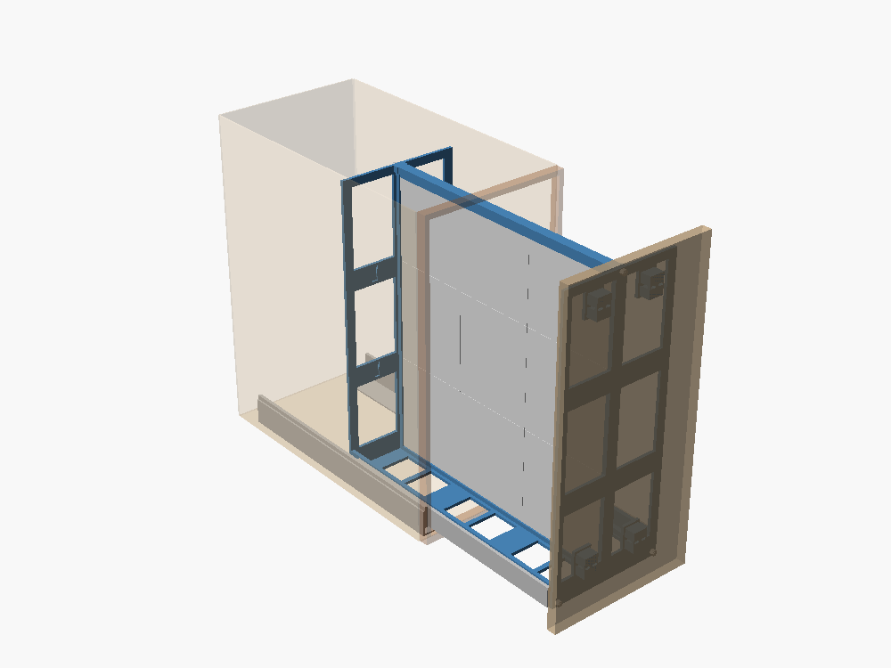
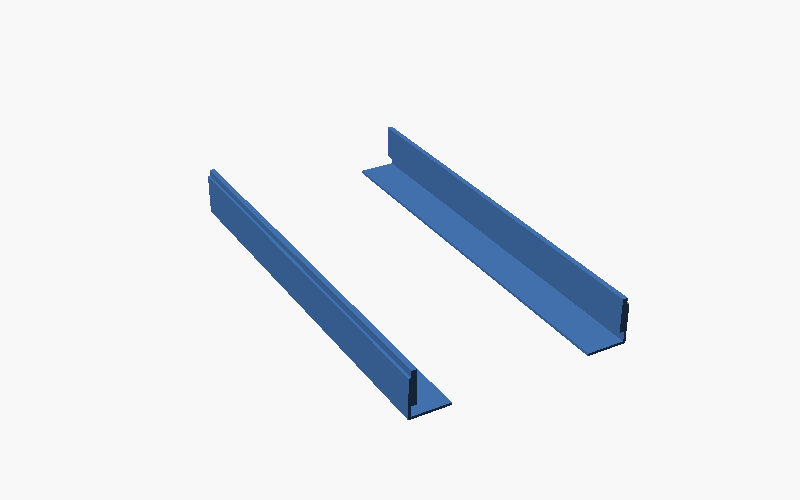
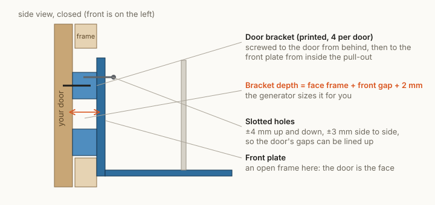

# Assembly and install

Allow an afternoon. You'll build the pull-out on a table, fit the rails in the cabinet, clip it in, then hang the door. The generator's **Install** steps are a short version of this page, with your exact rail positions filled in.

You'll need everything on the [hardware list](hardware.md), the printed parts, your openGrid boards, and the [tools](hardware.md#tools).

> **Is the cabinet fixed down?** A loaded pull-out at full extension puts its weight in front of the cabinet. Base cabinets and wall-hung cabinets are already screwed in place. A freestanding cabinet (a pantry unit, a hallway cupboard) needs an anti-tip strap or a couple of screws into a wall stud or its neighbour before you fit a pull-out. Tall units with several tiers matter most.

With [fixed shelves](measuring.md#fixed-shelves), build one pull-out per tier. The steps are the same; the rails for each tier go on its shelf.

## 1. Glue the plates

The front and rear plates come in pieces. Lay the pieces of each plate face-down in order, tap a bowtie key into each pocket across the seams with a little CA glue or epoxy, and let them cure flat. These are the only glued joints.

## 2. Cut the metal

Use the **Cut** list from the generator.

- **Tie rods**: cut to the listed length. File the ends so nuts thread on easily. Running a nut on before cutting and backing it off afterward cleans up the thread.
- **Aluminum angle** (if you chose it): cut two pieces to the slide length. File the cut ends.

## 3. Slides onto the base

Lay the base pieces in a row. Press the lever on each slide to unclip the inner member (the part that moves). Screw an inner member to the outside of each base cheek: front ends flush with the front of the base, centered on the cheek's height. The steel slide spans the seams between the base pieces, which is what holds the base straight.

## 4. Build the box

1. Stand the front plate against the front of the base and the rear plate against the back.
2. Push the two bottom tie rods through the plates and the beads along the inside of each cheek.
3. Add a washer and nut on each end. Snug them by hand for now.
4. Slide the openGrid boards down into the grooves in the plates and base. Connect neighboring boards with openGrid's pegs as you go.
5. Set each top rail on top of its boards, between the plates, and push its tie rod through.
6. Tighten every nut until snug and the box is square. **Don't crush the plastic**: snug, plus a quarter turn.

## 5. Rails in the cabinet

1. Screw the outer slide members to the upright leg of each aluminum angle, front ends flush. (Printed rails: screw them to the rail wall.)
2. Set the two rails on the cabinet floor with the horizontal legs pointing **inward**. The generator's **Install** step gives the exact spacing and position.
3. Clip the pull-out onto the slides and run it in and out. It should glide without binding. If it binds, the rails are too close or not parallel.
4. Mark the rail positions with tape or pencil, unclip the pull-out, and screw the rails to the floor through the inward legs. Drill the aluminum first; printed rails have holes already.

**Rails on a shelf:** the listed screws need a ¾″ (19 mm) shelf. On a thinner shelf, use shorter screws so the tips don't come through underneath.

**Stacked tiers with a mounted door:** every tier's rails must start the **same distance** behind the opening. Before you screw the last rails down, push all the tiers in and lay a straightedge across their front plates. They should all touch it.

## 6. Clip it in

Clip the pull-out back onto the slides and push it home. If your door stays hinged, you're done: snap on your accessories.

## 7. Mount the door

*Door-mount mode only. See [Mounting your door](door-mount.md) for why.*

1. Take the door off its hinges and remove the hinge mounting plates from the cabinet.
2. Screw the brackets to the front plate from inside the pull-out, through the slots, with the screws in the **middle** of the slots. A long screwdriver reaches the bottom pair. With stacked tiers, do this on every tier.
3. Put a square of double-sided tape on the face of each bracket.
4. Push the pull-out closed. Hold the door in its closed position with even gaps all round (coins or card make good spacers) and press it firmly onto the tape.
5. Pull out gently. Unscrew the brackets from the plate; they stay taped to the door.
6. Screw each bracket to the door through its two slotted holes.
7. Screw the brackets back onto the plate. Close the pull-out and check the gaps.

## 8. Adjust

- **Door too high or low**: loosen the plate screws and slide the door up or down (±4 mm).
- **Door off to one side**: loosen the door screws and slide it sideways (±3 mm).
- **Pull-out racks or wobbles**: tighten the tie rods a little, and check the rails are parallel.
- **One tier sits back from the door** (stacked tiers): put flat washers between that tier's brackets and the plate until the bracket touches the door.

Now snap openGrid hooks, bins and shelves onto both sides of each panel, or onto the open side of any [one-sided](door-mount.md#choosing-sides-for-each-pull-out) pull-out.
