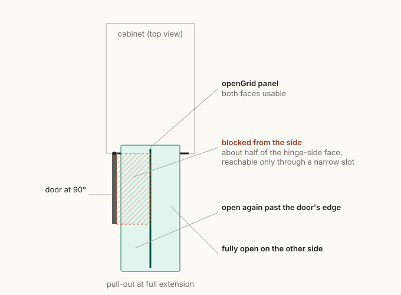
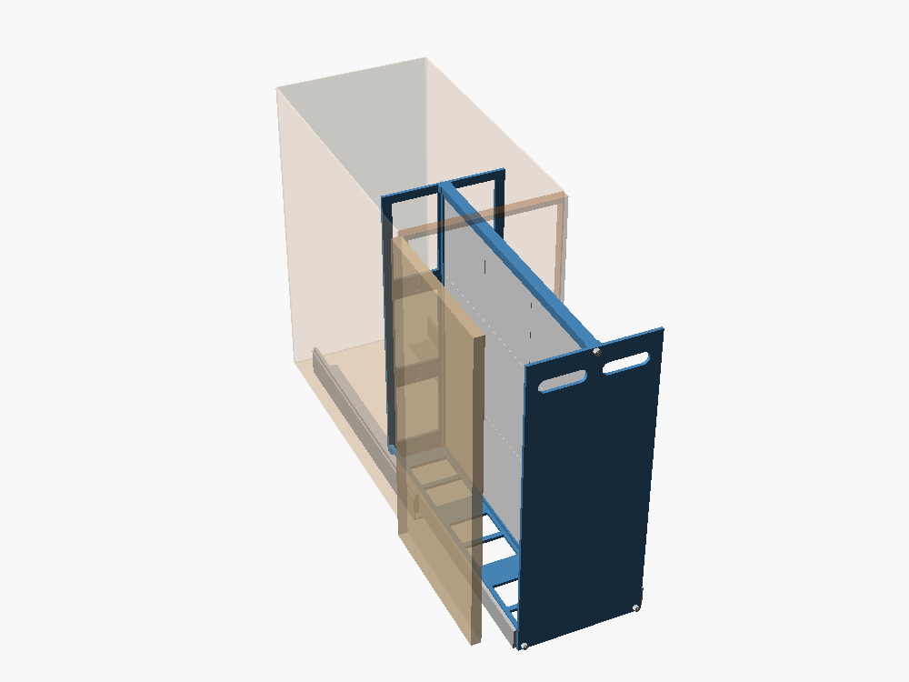
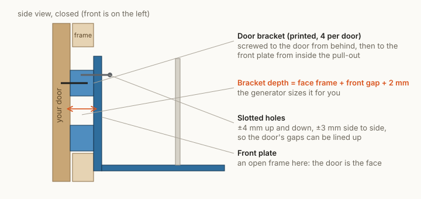

# Mounting your door on the pull-out

In door-mount mode (the default), your cabinet door comes off its hinges and screws to four printed brackets on the pull-out's front plate. The door becomes the pull-out's front, like a drawer. This is what commercial base-cabinet pull-outs do.

## Why mount it

Most cabinet hinges only open to about 90°. With the door hinged, it stands right beside the pulled-out shelf and covers about half of the hinge-side face. What hangs there is only reachable through a narrow slot between the door and the panel.

Mounting the door fixes that completely, and it also gives you width back: with no hinges inside the opening, the frame doesn't have to narrow itself to dodge them.

## How it works

- The **brackets** fill the gap between the back of your door and the front plate. The generator sizes them: face frame depth + front gap + 2 mm.
- Each bracket screws **to the door** with two wood screws through slotted holes (±3 mm side to side), then **to the front plate** with two screws from inside the pull-out, through slots in the plate (±4 mm up and down).
- The door closes against the face frame like it always did, and the slides take the weight. A typical cabinet door is far under the 100 lb (45 kg) slide rating.
- In door-mount mode, the front plate is an open frame instead of a solid sheet, since the door is the face. That saves a lot of plastic.

## Fitting the door

The full steps are in [Assembly](assembly.md#7-mount-the-door). The short version, which is the same trick the commercial kits use:

1. Screw the brackets to the front plate, in the middle of their slots.
2. Put a square of **double-sided tape** on the face of each bracket.
3. Push the pull-out closed, hold the door in its closed position with even gaps, and press it on.
4. Pull out gently. Unscrew the brackets from the plate (they stay stuck to the door), screw them to the door, then screw them back to the plate.
5. Use the slots to fine-tune the gaps.

## Taking the hinges off

Most modern concealed (Euro) hinges unclip from their mounting plates: push the lever or tab at the back of the hinge arm. Remove the mounting plates from the cabinet too, or they'll catch on the brackets. On face-frame cabinets the hinge cups stay in the door; they don't get in the way.

## When to keep the door hinged

Choose **Keep it hinged** in the generator if:

- **Your door is inset** (it sits inside the face frame opening rather than in front of it). Door mount assumes an overlay door and doesn't support inset doors yet.
- One door covers **more than the pull-out** (for example, a sink base where the pull-out only fills half).
- You want to be able to open the door without pulling the shelf out.

In keep-hinged mode the generator dodges your hinges, and the front plate is solid with finger slots. To reduce the blocked-side problem, swap to **170° hinges**: they're widely sold for both face-frame and frameless cabinets, use the standard 35 mm cup, and let the door swing flat out of the way. Match your door's overlay when you buy them.
