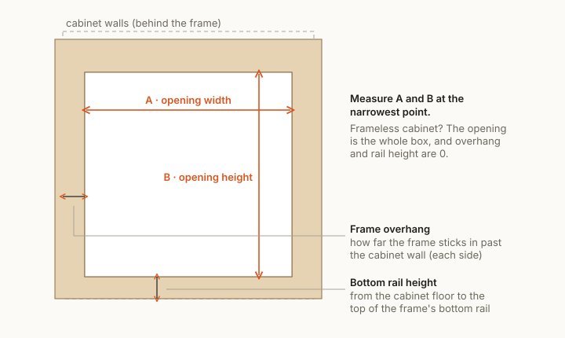
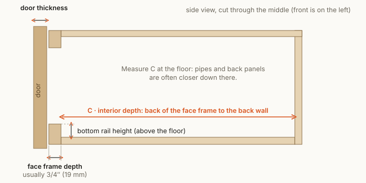

# Measuring your cabinet

Most cabinets need three numbers and two answers. Everything else has a sensible default you can override later. Measure in whichever units you like: the generator takes inches (fractions like `11 3/4` work) or millimetres, and you can type `mm` or `"` after any number to switch units for that field.

## The three numbers

**A · Opening width.** The clear width you could pass a box through: inside edge to inside edge of the face frame. Measure at the top, middle and bottom and use the smallest.

**B · Opening height.** The clear height, from the top of the bottom rail to the underside of the top rail.

**C · Interior depth.** From the back of the face frame to the back wall, **measured at the floor**. Pipes, back panels and plumbing access holes are often closer at floor level.

## The two answers

**Cabinet type.** Look at the front edge of the cabinet.
- **Face frame**: a wooden frame (usually 1½–2″ wide) is glued to the front of the box, and the opening is smaller than the inside of the box. Common in North America.
- **Frameless**: no frame, so the opening is the whole box. Common in Europe, Australia, and IKEA kitchens.

**Your door.** Will you [mount it on the pull-out](door-mount.md) (recommended) or keep it hinged? If you keep it, tell the generator which side the hinges are on.

## Optional numbers

Open **Advanced** in the generator only if your cabinet differs from the defaults.

| Measurement | Default | When to measure it |
|---|---|---|
| Frame overhang (left, right) | 10 mm face frame, 0 frameless | Your frame sticks in a lot further, or unevenly |
| Bottom rail height | 15 mm face frame, 0 frameless | Measure from the cabinet floor to the top of the bottom rail. **This one matters**: a tall rail raises the slides and can call for bigger rails |
| Top rail drop | 10 mm face frame, 0 frameless | Rarely matters |
| Face frame depth | 19 mm (3/4″) | Sets the door bracket depth if you mount the door |
| Rear width, rear height | Same as the front | The back of the cabinet is narrower or lower than the front (corner cabinets, sloped backs) |
| Door thickness | 19 mm (3/4″) | Door mount: the bracket screws need at least 15 mm of door |

The defaults are educated guesses that haven't been checked against many real cabinets yet. If yours are different, measure.

## Things in the way

Pipes, a garbage disposal, a drain trap, shelf pin strips: add them in **Expert: keep-outs** as boxes. Positions are measured from the inside front-left floor corner:

- **X**: across, from the left wall
- **Y**: into the cabinet, from the back of the face frame
- **Z**: up, from the floor

Then give each one a width, depth and height. Be generous: round up and add a little.

The generator tries every way of dodging each obstacle (narrower, shorter, lower, raised floor) and keeps whichever loses the least space. The report tells you what each one cost.

## Check before you print

- The generator's **3D preview** shows your cabinet as a ghost box. If something looks wrong, a measurement is probably wrong.
- Measure **twice** at the narrowest points. A pull-out that's 3 mm too wide doesn't go in.
- Use **Copy link** to save your settings. The link reloads the exact same pull-out later.
