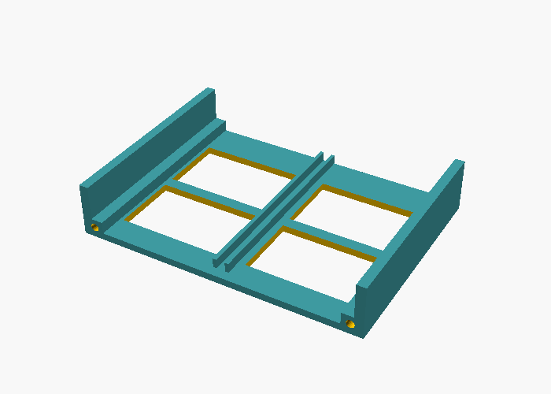
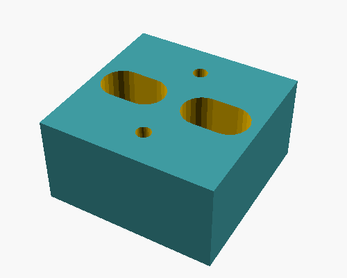

# Printing

The generator's zip contains every part as an STL, already oriented for printing and split to fit your bed. File names carry the quantity: `09-bracket-x4.stl` means print four. Printing on a Bambu Lab printer? The zip also holds a [ready-to-print project](#bambu-studio-and-orcaslicer).

## Bambu Studio and OrcaSlicer

Pick your printer next to the download buttons, then download **Bambu Studio project (.3mf)** (it's in the zip too). Open it and everything is set up:

- **Plate 1 is the test piece**: one base piece on its own. Print it and [test-fit it](#test-print-first) before the rest.
- Every other part is laid out on plates, grouped by part, with copies already made. Plate names say what's on them: *Front plate 2 of 3*, *Brackets and keys ×14*.
- Walls and infill are set **per part** (5 walls on parts that hold screws, 4 elsewhere, 25% gyroid), so they survive a change of process preset.
- Parts stay clear of the front-left calibration corner on P1 and X1 printers.

The project starts on Bambu's own **0.20mm Standard** process and **Generic PETG**. Pick your actual filament (or let the AMS sync it) before slicing. If your printer model isn't in the list, pick the closest and switch printers in Studio: the plates and per-part settings carry over.

With fixed shelves you get **one project per tier** (*…-tier1.3mf*, *…-tier2.3mf*), each with exactly the parts that tier needs, so you can print and fit one tier at a time. The test piece is on plate 1 of the first. Bambu Studio holds at most 36 plates per project, so a tier that needs more comes as two files.

Other slicers: use the STLs. Settings are in the table below.

## Material and settings

**PETG or PETG-GF.** Under-sink cabinets get warm and humid, and the parts carry weight for years. PLA creeps under steady load, so avoid it for the base and plates.

| Setting | Value |
|---|---|
| Layer height | 0.2 mm |
| Walls | 4 (5 for the base and printed rails, which hold screws) |
| Infill | 25% gyroid |
| Supports | None needed |
| Brim | Optional on the long base and rail pieces if your bed is fussy |

Everything is oriented for you: plates print face-down, top rails print cap-down, brackets print door-side-down, bar and arch handles print on their side, knobs print face-down. Don't rotate them.

## What you'll print

| Part | What it does |
|---|---|
| **Base** (usually 3 pieces) | The tray the slides screw to. Grooves hold the bottom of the boards; beads along each side carry the tie rods |
| **Front plate** (3 pieces) | Carries the door brackets. An open frame in door-mount mode; a solid face with your choice of handles if you keep the door hinged or have none |
| **Rear plate** (3 pieces) | Open frame with grooves for the back of the boards |
| **Top rail** (3 pieces per panel) | Caps the boards and ties the plates together at the top |
| **Door bracket** (4 per door) | Door-mount mode only |
| **Handles or knobs** | Only if you picked printed ones. Screw on from inside the front plate |
| **Bowtie keys** | Glue into the plate seams |
| **Floor rails** | Only if you chose printed rails |

 

## openGrid boards

PullGrid doesn't print the panels itself: you print standard **openGrid** boards from [openGrid's own files](https://www.printables.com/model/1214361-opengrid-walldesk-mounting-framework-and-ecosystem), so every openGrid snap and accessory fits exactly. The generator's **openGrid boards** list gives the sizes in cells (wide × tall) and how many of each.

- Use **Full** boards: they're 6.8 mm thick and usable from both sides.
- **Lite** boards (4 mm) work if you set *Board type* to Lite, but only one side takes accessories.
- You'll also need openGrid's connector pegs for the seams between boards.

## Test print first

PullGrid is in beta, so before printing about a kilo of plastic:

1. **Print `base_1` only.**
2. **Hold a slide against the cheek.** The inner member should sit flat, and its holes should land on solid plastic. Drive one screw and check it holds.
3. **Push an openGrid board into the groove.** It should slide in with light friction, not rattle and not jam.
4. **Push your threaded rod through the bead.** It should pass freely.

If the board is too tight or loose, your printer runs a little over or under size. Adjust your slicer's XY compensation, or open an [issue](https://github.com/Phorbie/PullGrid/issues) with what you found: that's exactly the feedback the project needs right now.

## How much plastic

The generator's **Print** line estimates the total. For a typical 11″ × 24″ × 22″ cabinet with a mounted door it's roughly 1 kg of PETG. Printed rails add about a fifth more.
